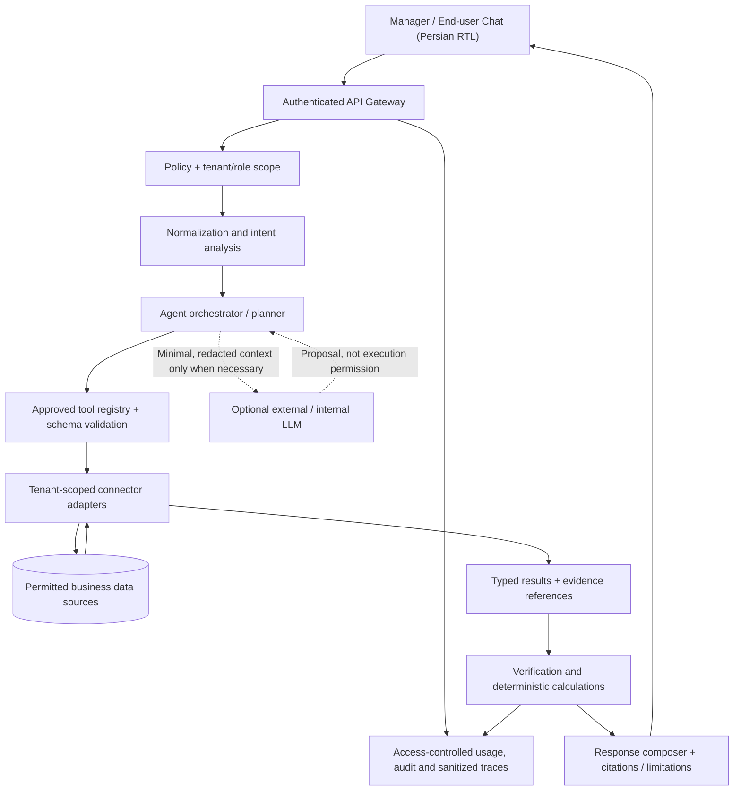

# Darik AI — Public Architecture & Engineering Case Study

> **Scope:** A security-conscious, public *reference architecture* for an AI gateway and agentic business assistant. **Not** a source-code release, production configuration, independent audit, or claim that every diagrammed component is live in production. The implementation details, deployment state and benchmark numbers require separate evidence.  
> **Updated:** 2026-10-13 · **Status:** Architectural overview; some capabilities have been implemented/tested in isolated environments, while production readiness is not asserted here.

## 1. Problem, goals and boundaries

Darik is designed to help Persian-speaking e-commerce teams use natural-language interfaces to ask operational questions and retrieve **evidence-backed** answers grounded in authorized business data, without exposing internal database structure or third-party credentials to the user. A second use case is configurable customer-facing conversation over approved business knowledge.

**Goals**

1. Separate user intent from tool execution. A model suggests a constrained plan; server-side policy decides what can execute.
2. Preserve tenant and role isolation through every query and connector.
3. Make business claims *verifiable* by linking calculated results to trusted source records and time windows.
4. Minimize exposure, storage and provider transfer of personal/business data.
5. Control cost via small-model routing, caching only where safe, deterministic computations and usage accounting.
6. Provide Persian/RTL-compatible UX, including error and ambiguity handling.

**Non-goals for this public document:** published production endpoint URLs, source code, database credentials, tenant identifiers, internal query templates, production infrastructure topology, concrete SLAs or customer benchmarks.

## 2. Architecture at a glance

**Trust boundaries:** user/browser (untrusted) → authenticated service (trusted for policy checks) → narrowly scoped connector (trusted only for its authorized operation) → data source. Model output and retrieved data are both **untrusted inputs**; neither confers permission to call tools, select tenants, or mutate data.

## 3. Responsibilities by component

| Component | Responsibility | Invariant |
| --- | --- | --- |
| Chat / UI | Collect a question, display progress, evidence and uncertainty | Never trust browser-supplied tenant or role |
| API / gateway | Authentication, rate limits, tenant context, request IDs | Credentials remain server-side |
| Normalization | Persian digits, Arabic/Persian glyph variants, dates and business terminology | Original intent must not be silently changed |
| Intent / classifier | Map questions to supported intents and identify missing parameters | Low confidence => clarification, not arbitrary execution |
| Orchestrator | Compose bounded multi-step plans and control retries/timeouts | Plan is not a permission grant |
| Tool registry | Versioned contracts for approved read/action tools | Validate arguments and restrict tools by role |
| Connector | Enforce least-privilege adapter queries and map results to typed objects | Server derives tenant scope; no raw SQL/DSL from model |
| Evidence / verification | Reconcile amounts, counts, periods and units; detect incomplete data | No unsupported numeric conclusions |
| Response composer | Explain answer, source window and uncertainty | Distinguish facts, inference and unavailable information |
| Audit / telemetry | Measure latency, costs, refusals, errors; sanitized correlation | Sensitive payloads excluded by design |

These are **logical responsibilities**, not necessarily a one-to-one map to separate services or deployables.

## 4. Example: a multi-step business question

Question (illustrative, using **synthetic** figures): “فروش هفت روز گذشته چرا کمتر از هفتهٔ قبل بوده؟”

1. **Parse** both date windows with a named business timezone and an explicit rule for inclusive/exclusive timestamps.
2. **Authorize** the caller's permission to read sales aggregates for their tenant; reject out-of-scope dimensions.
3. **Plan** bounded reads for order counts, finalized sales and relevant product/category summaries.
4. **Validate** each proposed tool call against schema, constraints and maximum ranges.
5. **Execute** read-only adapter calls; use the source-of-truth business status definitions and consistent currency units.
6. **Calculate** totals, AOV and differences with deterministic code (not model mental arithmetic).
7. **Verify** source row counts, partial results, missing periods, duplicate records and disagreements before forming a claim.
8. **Answer** with traceable time windows, metrics and evidence references; offer hypotheses only as hypotheses.

For example, if synthetic week A has 8 paid orders totaling 4,000 units and week B has 10 totaling 6,000 units, the order-count change is `-20%`, revenue change `-33.3%` and AOV drops from 600 to 500 units. A decline in AOV is *observed*, but a particular business cause cannot be asserted without corresponding evidence.

## 5. Read operations vs mutations

**Read-only analytics** can use allowlisted tools such as sales/order aggregates, product ranking, inventory checks and period comparison, subject to authorization and query limits.

**Mutation-capable operations**, if offered in a future integration, should require all of:

- Explicit capability separately granted by a human administrator (default deny).
- Field-level allowlists, a preview of proposed changes, and explicit user confirmation.
- Idempotency keys, dry-run where applicable, authoritative before/after verification and immutable audit metadata.
- Separation between tool *suggestion* and execution on the server.
- A rollback or compensating action plan for irreversible/critical tasks.

Publishing the interface name is not proof that mutation is enabled or deployed.

## 6. Data types, evidence, units and ambiguity

- **Timestamps:** choose one timezone for a business calculation; store canonical UTC when applicable; display local date/calendar separately.
- **Money:** use integer minor units or exact decimals with documented currency; never compare formatted strings or silently mix IRR/IRT.
- **Status:** paid/refunded/cancelled definitions must be explicit and consistent across tools.
- **Identity:** protect customers' personal fields; prefer aggregates and opaque IDs in summaries.
- **Provenance:** every nontrivial reported value needs origin, filter, sampling constraints, time window and calculation method.
- **Ambiguity:** if user says “اول هفته” without a calendar rule, ask or show the assumed period before making consequential claims.
- **Missing data:** zero records, null values and failed queries are distinct; a failed tool is not a zero balance.
- **Uncertainty:** do not invent a reason for fluctuations; distinguish explanatory hypotheses from measured evidence.

## 7. Memory, privacy and provider boundaries

The *design aim* is to avoid retaining raw customer conversations unnecessarily. “Zero retention” is a **target policy to verify per deployment**, not a claim that logs, backups, all providers or transports automatically comply.

Data-handling controls proposed for each integration:

1. Minimize context before any LLM request; redact direct identifiers and credentials.
2. Enforce per-tenant isolation at the server and connector level, including cache keys.
3. Store only approved reusable **patterns or knowledge** after validation and review; never assume raw conversations are safe to store.
4. Apply documented retention limits to audit/traces, backups, errors, embeddings and provider processing.
5. Record model/provider usage without leaking prompts, access tokens or personal information to logs.
6. Provide explicit deletion, export and incident-handling procedures where required.

See [SECURITY_MODEL.md](SECURITY_MODEL.md) for assumptions and threat-model examples.

## 8. Reliability & observability (reference controls)

- **Timeout budgets:** bound total request duration and per-tool deadlines.
- **Retries:** only bounded, safe/idempotent operations with backoff.
- **Limits:** cap tool call count, rows, date range, token budget and depth to prevent runaway agents.
- **Circuit breakers:** isolate failing providers/connectors; return partial status, not fabricated results.
- **Traces:** log stage status (intent → authorization → plan → tool → verification), duration, cost and sanitized correlation IDs.
- **Metrics:** answer verification rate, authorization denials, tool error rate, p95 latency, user-visible failure rate and estimated provider cost.
- **Evaluation:** keep regression scenarios with synthetic fixtures, deterministic expected values, refusal/ambiguous input cases and adversarial content.

A passing test suite is evidence for *the tested code at that revision*, not evidence of production reliability or independent security certification.

## 9. Security model summary

| Risk | Architectural control | Validation evidence to collect |
| --- | --- | --- |
| Cross-tenant data exposure | Server-originated tenant scope + connector enforcement | Multi-tenant negative tests |
| Prompt injection from retrieved content | Untrusted-content boundary + allowlisted tool policy | Adversarial fixture evaluation |
| Unauthorized write | Default deny + explicit approval + dry-run | Role and confirmation tests |
| Financial miscalculation | Exact units + deterministic arithmetic + evidence verifier | Golden tests with refunds and zeros |
| Provider data leakage | Redaction + configurable model routing and retention | DLP tests + provider agreements |
| Excessive cost / looping | Steps, tokens and query budget caps | Budget exhaustion test |
| Missing/stale results | Source timestamps + partial-result flags | Failure-injection tests |

## 10. Logical deployment and lifecycle

This repository **does not deploy Darik**. A deployment may contain API services, a relational metadata store, cache/queue infrastructure, an LLM relay, a control panel and one or more tenant connectors. The precise technologies/topology depend on operational constraints and must not be inferred from this document.

Typical lifecycle: requirement → typed connector contract → synthetic fixtures → automated evaluation → staging with scoped credentials → security/privacy review → limited rollout → monitored production. A staging PASS does not authorize production access.

## 11. Engineering trade-offs

- **Deterministic tooling over LLM-only answers:** more integration work, but auditable metrics.
- **Allowlisted connectors over unrestricted queries:** less flexibility, much safer tenant and data isolation.
- **Minimal/redacted context over raw chat history:** fewer privacy risks, but may require explicit user clarification.
- **Small-model routing / non-LLM fast paths:** lower costs, but requires confidence calibration and fallback rules.
- **Explicit human approval for writes:** additional friction, but avoids silent irreversible changes.

See [ENGINEERING_DECISIONS.md](ENGINEERING_DECISIONS.md) for short ADR-style rationale.

## 12. Maturity and evidence boundaries

**Publicly documented:** intended responsibilities, security boundaries, representative query flow, data contracts and quality controls.

**Not independently verifiable from this public repository:** current production availability, completion percentage, LLM/provider benchmark results, exact savings, tenant count, security audit outcomes or integration SLAs. Such claims require dated test reports or sanitized artifacts.

**Private by design:** implementation source, real traces, customer names/order data, infrastructure endpoints, API keys, prompt libraries and internal runbooks. This repo intentionally contains **no executable Darik backend**.

## 13. Next public-safe artifacts

- Sanitized sequence diagrams for authenticated query and rejected authorization paths.
- Synthetic multi-step evaluation with pass/fail criteria and no client records.
- Data dictionary showing money/date/status semantics without private schemas.
- A decision log for tool calls, validation, privacy and model routing.
- Screenshots or a demo **only when permission to publish is confirmed**.

---

**Maintainer note:** This case study describes architecture and trade-offs without disclosing deployable internals. For any decision where source and documentation disagree, the current source and signed test evidence take precedence.
