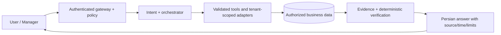

# Darik AI — Public Engineering Overview

**AI Gateway · Evidence-backed business analytics · Agentic orchestration · Persian-first UX**

> This repository is a **public architecture/case-study portfolio**, not the Darik application source and not an advertisement of verified production uptime, customer counts or model benchmarks.

**فارسی:** داریک یک چارچوب اتصال کنترل‌شدهٔ دستیار هوشمند به داده‌های مجاز کسب‌وکار است. هدف، پاسخ‌های قابل استناد و مدیریت ایمن درخواست‌های چندمرحله‌ای است. در این مخزن، معماری در سطح عمومی ارائه شده و هیچ کد محرمانه، اطلاعات مشتری یا تنظیمات اجرایی منتشر نمی‌شود.

## The engineering problem

A normal chatbot can write fluent Persian while returning unreliable operational numbers. An enterprise/business assistant needs **permissions, bounded tools, provenance, precise arithmetic, privacy and failure handling** instead of trusting model-generated SQL or unsupported explanations.

### Public system boundaries

### Representative capabilities (design scope)

- Persian normalization, intent classification and ambiguity handling.
- Structured, permission-scoped read tools for business questions.
- Multi-step comparison of revenue, orders, product ranking and inventory signals.
- Evidence-aware response generation with exact units/time periods.
- Optional LLM routing with contextual redaction and cost controls.
- Sanitized, access-controlled traces and evaluation fixtures.
- Controlled/approved customer support conversations.

These are **logical architectural capabilities**. Public documentation does **not** prove that each is deployed for real customers.

## Explore the case study

- [**Architecture** — system boundaries, tool flow, data types and example evaluation](ARCHITECTURE.md)
- [**Security model** — threats, privacy and authorization checks](SECURITY_MODEL.md)
- [**Engineering decisions** — trade-offs, constraints and design rationale](ENGINEERING_DECISIONS.md)
- [**Security reporting**](SECURITY.md)

## Demonstrating functionality responsibly

A reproducible public demo should use **synthetic orders/customers**, a simulated read-only adapter and predetermined expected results. Production records, real prompts, provider keys and internal request/response payloads belong in private repositories and internal test systems. No public SDK or functional local backend is included here.

## Technical direction

Representative design concepts: TypeScript/NestJS APIs, typed connector contracts, relational metadata, cache/queue layers when justified, model gateway, staged evaluations, and a Persian/RTL interface. Exact implementation choices and deployed topology remain private and may change.

## Current evidence / maturity

- **Verified in this repository:** authored architecture and threat-model documentation, no private application source.
- **Not independently verified here:** production deployment, data retention guarantees, integration breadth, provider cost reductions, external security certification or benchmark scores.
- **Roadmap for public-safe proof:** synthetic evaluation report, sanitised architecture diagrams, documented error taxonomy and case studies approved for publication.

## Contact and collaboration

Open an issue for documentation feedback, or use the maintainer contact in GitHub for private vulnerability reports. Do not submit customer data or credentials in Issues.
